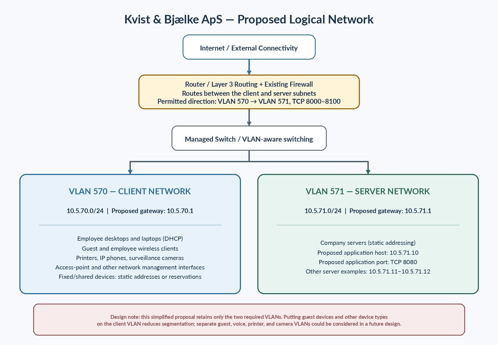

# Codebase
## 1. Password Hashing

To assure security of the application's users', password hashing was introduced. Passwords are never stored or accessible in plaintext, but hashed using unique salt instead (Argon2) - this prevents brute-force attacks. On top of that, constant-time comparison is used during verification to prevent timing attacks. Comparing by == checks every character one by one and returns false once it hits a mismatch. Constant time comparison returns true/false once the whole string is checked, prevents potential attackers to draw conclusions based on the response time.

## 2. User Login & Access Tokens (JWT)
To increase security of the application, JSON Web Tokens were introduced. Instead of remembering current user's id, which is prone to attacks, a token is created on log-in. It is stored in a database session and includes identification of the logged-in user, their role (used in role based authorisation described below), and an expiry point. The backend contains a key that encrypts the token and makes in un-readable. Even it the token happens to be intercepted and tampered with, it will be rejected by the server. The Token is passed on every time identification of the current user is needed.

## 3. Role-based Access Control
As an additional layer of security, regular users cannot hit administrative endpoints even if they find the API link. It was achieved by attaching [Authorize(Roles = "Admin")]. Instead of checking roles on the frontend (which a user could bypass in their browser's dev tools), the backend verifies the role inside the cryptographically signed token before running the request. [AllowAnonymous] - lets all users use the endpoint
[Authorize] - only logged in users are allow to use the endpoint
[Authorized(Roles = "XYZ")] - only users with role XYZ are allowed to use the endpoint.

# CDS.infrastructure — Proposed Network Design

**Company:** Kvist & Bjælke ApS  
**Scope:** This is a theoretical proposal for the company’s network, not an implementation or test report.

## 1. Company requirements

The design considers the company’s current devices and room for future growth.

| Device | Quantity | Purpose |
|---|---:|---|
| Desktop computers | 15 | Administration and office work |
| Laptops | 10 | Employees working from different locations |
| Network printers | 3 | Shared printing |
| Servers | 3 | Internal systems and applications |
| IP phones | 12 | Network-based telephony |
| Wireless access points | 4 | Employee and guest wireless access |
| Surveillance cameras | 6 | IP-based video surveillance |
| Network equipment | As required | Switching, routing, and connectivity |
| Guest devices | Variable | Visitors’ smartphones and computers |

## 2. Proposed network architecture

The proposal uses the two VLANs specified in the assignment: VLAN 570 for clients and VLAN 571 for servers. Keeping only these two segments makes the design straightforward, while separating users from the systems hosting applications.

| VLAN | Network | Devices and purpose |
|---|---|---|
| **570 — Client** | `10.5.70.0/24` | Employee computers and laptops. For this simplified design, printers, phones, cameras, access-point management, and guest devices also use this VLAN. |
| **571 — Server** | `10.5.71.0/24` | The company’s three servers and hosted applications. |

Placing guest and other device types in the client VLAN reduces isolation between them. Separate guest, voice, printer, camera, and management VLANs could improve separation in a future design but are outside this proposal’s scope.

## 3. IP addressing plan

The assignment specifies both `/24` networks. The gateway addresses and address allocations below are proposed values.

| Property | VLAN 570 — Client | VLAN 571 — Server |
|---|---|---|
| Network / CIDR | `10.5.70.0/24` | `10.5.71.0/24` |
| Subnet mask | `255.255.255.0` | `255.255.255.0` |
| Proposed default gateway | `10.5.70.1` | `10.5.71.1` |
| Usable host range | `10.5.70.1–10.5.70.254` | `10.5.71.1–10.5.71.254` |
| Broadcast address | `10.5.70.255` | `10.5.71.255` |
| Total / usable addresses | 256 / 254 | 256 / 254 |

### Proposed address allocation

**VLAN 570 — Client network**

| Address or range | Purpose | Method |
|---|---|---|
| `10.5.70.1` | Default gateway | Static |
| `10.5.70.2–10.5.70.19` | Network equipment and access-point management | Static |
| `10.5.70.20–10.5.70.49` | Printers, phones, cameras, and other fixed/shared devices | Static; DHCP reservations are an alternative if required |
| `10.5.70.50–10.5.70.199` | Employee and wireless client devices | DHCP pool (150 addresses) |
| `10.5.70.200–10.5.70.254` | Future growth and additional reservations | Reserved |

**VLAN 571 — Server network**

| Address or range | Purpose | Method |
|---|---|---|
| `10.5.71.1` | Default gateway | Static |
| `10.5.71.2–10.5.71.9` | Reserved server-network addresses | Reserved |
| `10.5.71.10` | Proposed application host / Ubuntu Server VM | Static |
| `10.5.71.11–10.5.71.12` | Other company servers | Static |
| `10.5.71.13–10.5.71.49` | Additional servers and infrastructure | Reserved for static allocation |
| `10.5.71.50–10.5.71.254` | Future server capacity | Unallocated |

## 4. Subnetting

Both networks use a `/24` prefix. IPv4 addresses contain 32 bits, leaving 8 host bits in a `/24` subnet:

`2^(32 − 24) = 2^8 = 256 total addresses`

After excluding the network and broadcast addresses:

`256 − 2 = 254 usable host addresses`

| Network | Network address | Subnet mask | Usable hosts | Why `/24` fits |
|---|---|---|---:|---|
| Client VLAN 570 | `10.5.70.0/24` | `255.255.255.0` | 254 | Supports 25 employee computers and other client-side devices, with capacity for growth. |
| Server VLAN 571 | `10.5.71.0/24` | `255.255.255.0` | 254 | Easily accommodates the three required servers and additional systems. |

## 5. Routing, firewall, and application port

VLAN 570 and VLAN 571 are separate IP subnets, so communication between them normally requires Layer 3 routing. The assignment states that the existing firewall permits the required traffic from VLAN 570 to VLAN 571 on TCP ports `8000–8100`; configuring those network firewall rules is outside the assignment’s scope.

Allowing only the ports required by an application limits unnecessary exposure. The proposed application port is **TCP `8080`**, with the planned endpoint `10.5.71.10:8080`.

## 6. Proposed network diagram

*Figure 1. The proposed logical layout, showing external connectivity, routing and the existing firewall, switching, and the two required VLANs.*

## 7. Design decisions

| Design consideration | Decision |
|---|---|
| Device types need different levels of network separation, but the assignment provides two VLANs. | Keep the required client/server split; this is simple but gives less isolation to non-server devices. |
| Mobile devices and fixed systems need different addressing methods. | Use DHCP for end-user devices, static addresses for servers and infrastructure, and static addresses or reservations for fixed/shared devices. |
| The assignment does not specify default gateways. | Propose `10.5.70.1` and `10.5.71.1`; confirm them against the network design before implementation. |

## 8. Summary of CDS.Infrastructure part

The proposal separates clients (`10.5.70.0/24`) from servers (`10.5.71.0/24`), with 254 usable host addresses per subnet. The two-VLAN design meets the stated requirements while keeping the network simple; additional segmentation could be considered as the company grows.

# Deployment

For the deployment phase, we used some of the following Ubuntu terminal commands:
- sudo snap install docker
- docker-compose
- sudo docker ps
- git clone https://github.com/taszaszasza/AhojManagement.git
- cd AhojManagement
- sudo docker compose version
- sudo docker compose up -d build
- sudo docker compose ps
- ip -4 addr show

At this point, we switched to the client VM 570 and we tried to reach the url http://10.5.71.112:8080, which successfully led us to the login page of the application:

# Reflections

This project helped us understand how application security and infrastructure work together. In AhojManagement, Argon2 password hashing, JWT authentication and backend role checks protect user accounts and application functionality. The server and network configuration determine how the application can be accessed, so both layers are important. However, in this project we ended up developing security at the backend/frontend level, rather than being involved in the implementation and deployment of a real-world infrastructure security deployment.

One challenge was that Ubuntu commands and network settings can differ between versions. We also had to understand Docker port mapping and how the client reaches the application. We deployed AhojManagement on an Ubuntu Server VM on VLAN 571 and accessed it from an Ubuntu Desktop VM on VLAN 570 through port 8080. We also learned that the proposed network for Kvist & Bjælke ApS is a separate theoretical task: the proposed design of the company in the CDS Infrastructure part does not represent the pre-requisite for the deployment of our security application.

For a real company, we would add HTTPS, handle secrets carefully, keep the server and containers updated, and introduce monitoring and backups. We would also consider separate VLANs for guest devices, cameras and other equipment to improve isolation. Before going into production, we would test the complete setup and its recovery process.

## Reference

Kvist & Bjælke ApS, *CDS.infrastructure assignment brief* supplied for this project.
Auth0. (n.d.). Introduction to JSON Web Tokens. jwt.io. Retrieved October 29, 2026, from https://jwt.io/introduction#what-is-json-web-token
Google. (2026). Gemini (Feb 2026 version) [Large language model]. https://gemini.google.com - used for generating CSS styling, brain storming ideas, and explaining concepts.
